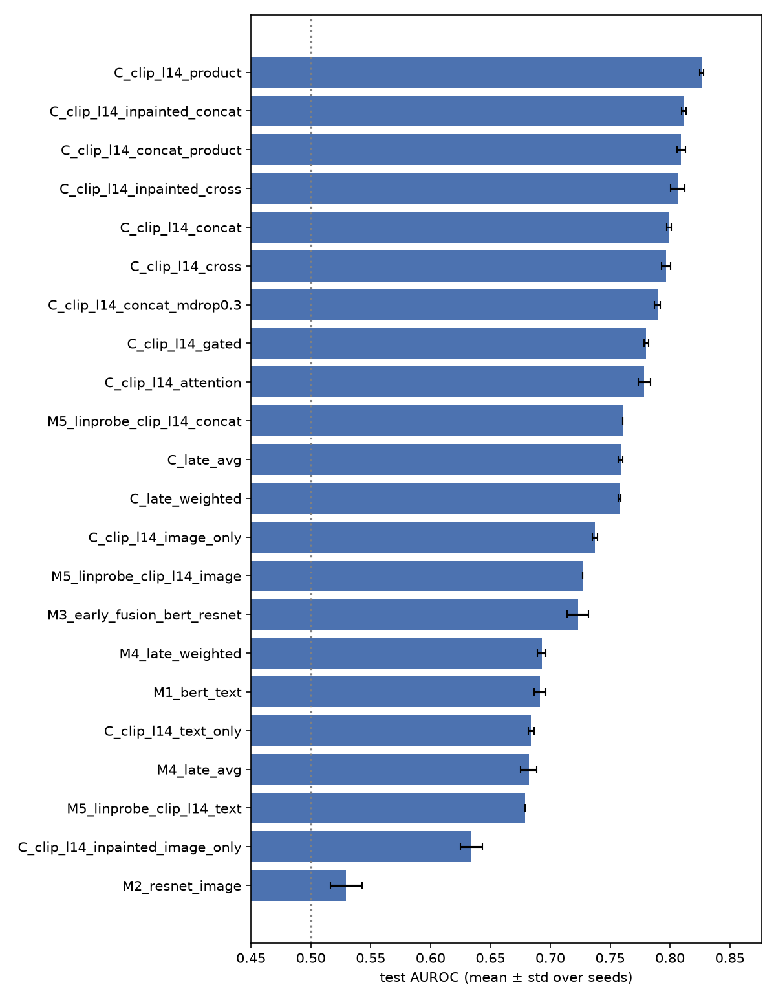

# Multimodal Hateful Meme Detection: Does Fusion Beat Unimodal?

Deep Learning course project (Sem 5, Sitare University).

**Report:** [`report/Report.pdf`](report/Report.pdf)

We classify memes from the **Hateful Memes Challenge** (Kiela et al., NeurIPS 2020) as hateful or not. The dataset is
built with *benign confounders*: the same caption on a different image, or the same image with a different caption,
flips the label. Because of that, a model has to understand image and text **together** to get these memes right.

**Research questions**
1. Does fusing image and text beat the best single-modality model, and by how much?
2. Which **fusion strategy** works best on top of frozen CLIP embeddings? (concat, product, cross, gated, attention, late)
3. How do models perform on **benign-confounder pairs**, compared with the rest of the data?
4. Does a model really use both modalities? (test-time modality shuffling)
5. Is a CLIP "image-only" model really image-only? CLIP can read the caption printed in the image, so we test this by removing the text from the image first.

## Models

| ID | Model | Script |
|----|-------|--------|
| M1 | BERT (bert-base-uncased) fine-tuned, text only | `train_unimodal.py --modality text` |
| M2 | ResNet-50 (ImageNet) fine-tuned, image only | `train_unimodal.py --modality image` |
| M3 | Early fusion: [BERT CLS ; ResNet] → MLP, trained end-to-end | `train_unimodal.py --modality both` |
| M4 | Late fusion of M1 + M2 probabilities (average / val-tuned weight) | `late_fusion.py` |
| M5 | CLIP ViT-L/14 linear probe (logistic regression) | `linear_probe.py` |
| M6 | Frozen CLIP + MLP head (concat) | `train_head.py --fusion concat` |
| M7 | Frozen CLIP + cross fusion (Hate-CLIPper style) | `train_head.py --fusion cross` |
| Ablation | image_only, text_only, product, concat_product, gated, attention, modality dropout | `train_head.py --fusion ...` |

Every model is trained with **3 seeds**, selected on **val** AUROC, and reported as mean ± std on **test**.
Splits: `train` = train (8.5k), `val` = dev_seen (500), `test` = test_seen (1000), plus `test_unseen` (2000) as an
extra test set. Metrics are **AUROC** (primary), accuracy, and F1.

## Repository layout

```
├── src/
│   ├── common.py            paths, metrics, saving runs
│   ├── download_data.py     dataset from Hugging Face → data/hateful_memes/
│   ├── prepare_splits.py    → data/splits/{train,val,test,test_unseen}.jsonl
│   ├── eda.py               dataset stats + figures
│   ├── train_unimodal.py    M1, M2, M3 (fine-tuned BERT / ResNet)
│   ├── late_fusion.py       M4
│   ├── extract_clip.py      cache CLIP image/text embeddings → features/
│   ├── linear_probe.py      M5
│   ├── fusion_heads.py      all fusion operators
│   ├── train_head.py        M6, M7 + fusion ablation
│   └── analysis/
│       ├── make_tables.py        results/summary.md + bar chart
│       ├── confounders.py        benign-confounder pair analysis
│       ├── modality_ablation.py  shuffle / remove one modality at test time
│       ├── inpaint_text.py       erase the caption from the images (OCR + inpainting)
│       └── error_examples.py     most confident false positives / negatives
├── notebooks/run_pipeline.ipynb  run everything on Colab / Kaggle
├── scripts/run_all.sh            same pipeline as one bash script
├── report/REPORT_TEMPLATE.md     report skeleton
└── results/                      metrics, predictions, figures (committed; model weights are not)
```

## How to run

You need a GPU. A free Colab or Kaggle **T4** is enough; a 4 GB laptop GPU is too small for fine-tuning BERT or ResNet.

```bash
pip install -r requirements.txt
python src/download_data.py && python src/prepare_splits.py
bash scripts/run_all.sh          # or run notebooks/run_pipeline.ipynb cell by cell
```

Approximate time on a T4: baselines ~2 h, CLIP features ~10 min, whole fusion ablation ~15 min,
inpainting ~75 min.

## Results

All numbers are on `test` (test_seen, 1,000 memes), mean ± std over 3 seeds (linear probe: 1 deterministic run).
Full tables: [`results/summary.md`](results/summary.md), [`results/confounders/results_test.md`](results/confounders/results_test.md),
[`results/modality_ablation_test.md`](results/modality_ablation_test.md), [`results/errors/`](results/errors/).



### 1. Does fusion beat unimodal? Yes, by about 0.09 AUROC

| Model | Test AUROC | Test Acc | Test-unseen AUROC |
|---|---|---|---|
| M2 ResNet-50, image only | 0.530 ± 0.013 | 0.509 | 0.548 |
| M1 BERT, text only | 0.691 ± 0.005 | 0.595 | 0.633 |
| M4 late fusion BERT + ResNet (weighted) | 0.693 ± 0.004 | 0.590 | 0.637 |
| M3 early fusion BERT + ResNet | 0.723 ± 0.009 | 0.626 | 0.685 |
| CLIP text only (MLP head) | 0.684 ± 0.002 | 0.608 | 0.630 |
| CLIP image only (MLP head) | 0.737 ± 0.002 | 0.655 | 0.742 |
| M5 CLIP linear probe (concat) | 0.760 | 0.669 | 0.740 |
| CLIP late fusion (average) | 0.759 ± 0.002 | 0.651 | 0.732 |
| M6 CLIP + MLP (concat) | 0.799 ± 0.002 | 0.718 | 0.795 |
| M7 CLIP cross fusion (Hate-CLIPper style) | 0.797 ± 0.004 | 0.721 | 0.785 |
| **CLIP product fusion (best)** | **0.826 ± 0.002** | **0.737** | **0.819** |

With the same frozen CLIP features, the best fusion head beats the best unimodal head by **+0.089 AUROC**
(0.826 vs 0.737). With fine-tuned BERT/ResNet, early fusion beats the best unimodal model by +0.032 (0.723 vs 0.691),
while late fusion adds almost nothing (0.693).

### 2. Fusion ablation on frozen CLIP ViT-L/14

| Fusion operator | Test AUROC |
|---|---|
| product `i * t` | **0.826 ± 0.002** |
| concat + product `[i; t; i*t; abs(i-t)]` | 0.809 ± 0.004 |
| concat `[i; t]` | 0.799 ± 0.002 |
| cross (outer product) | 0.797 ± 0.004 |
| concat + modality dropout 0.3 | 0.790 ± 0.002 |
| gated | 0.780 ± 0.002 |
| attention (2-layer Transformer) | 0.779 ± 0.005 |
| late fusion (average of unimodal heads) | 0.759 ± 0.002 |

Operators with an explicit image–text interaction (product) work best; every intermediate fusion beats late fusion,
which cannot model interactions at all. Larger heads (attention, gated) do not help on 8.5k training memes.

### 3. Benign confounders

404 confounder pairs in `test` (174 same-text pairs, 230 near-identical-image pairs, opposite labels).
`pair_rank` = how often the hateful meme of a pair gets the higher probability (0.5 = chance).

| Model | pair_rank | pair_acc (both correct) |
|---|---|---|
| M2 ResNet, image only | 0.471 | 0.039 |
| M1 BERT, text only | 0.555 | 0.145 |
| CLIP text only | 0.547 | 0.144 |
| CLIP image only | 0.706 | 0.341 |
| M3 early fusion BERT + ResNet | 0.740 | 0.289 |
| CLIP late fusion (average) | 0.809 | 0.283 |
| CLIP concat | 0.847 | 0.423 |
| **CLIP product** | **0.908** | **0.489** |

Text-only models are at chance on confounder pairs, as the dataset was designed for; fusion models separate the pairs
far better, and the best fusion head ranks the hateful twin higher in 91% of pairs.

### 4. Does the model use both modalities?

Shuffling one modality across memes at test time (AUROC of the best model, `C_clip_l14_product`):
original **0.826** → text shuffled **0.630** → image shuffled **0.601**. Both drops are large, so the model relies on
both modalities; every fusion head shows the same pattern.

### 5. Is CLIP "image-only" really image-only? No

Removing the printed caption from every image (EasyOCR + OpenCV inpainting) and retraining:

| Model | Original images | Caption removed |
|---|---|---|
| CLIP image only | 0.737 | **0.634** (−0.103) |
| CLIP concat | 0.799 | 0.812 (+0.012) |
| CLIP cross | 0.797 | 0.806 (+0.010) |

Much of the CLIP image-only score came from **reading the caption in the pixels**. For fusion the caption is already
given through the text encoder, so removing it from the image slightly helps.

### 6. Error analysis of the best model

264 test errors: 74 false positives, 190 false negatives (train is 35% hateful, test 49%, so the model under-predicts
hate). For the 20 most confident errors of each kind, categorised after viewing the images:
false negatives are mostly **image–text interaction** (10) and **world knowledge** (7); confident false positives are
mostly **label noise** (8) and **keyword over-reaction** (7), i.e. the dataset's benign confounders.
Details: [`results/errors/C_clip_l14_product_test.csv`](results/errors/C_clip_l14_product_test.csv).

### Data note

The `neuralcatcher/hateful_memes` mirror is missing 2,476 of the 12,140 images; `download_data.py` fills them from
`limjiayi/hateful_memes_expanded` (images only – its extra training memes are not used), so all splits are complete.

## Team

See [`TEAM_PLAN.md`](TEAM_PLAN.md) for who built and ran each part.

## References
1. Kiela et al., *The Hateful Memes Challenge: Detecting Hate Speech in Multimodal Memes*, NeurIPS 2020. arXiv:2005.04790
2. Radford et al., *Learning Transferable Visual Models From Natural Language Supervision (CLIP)*, ICML 2021. arXiv:2103.00020
3. Kumar & Nandakumar, *Hate-CLIPper: Multimodal Hateful Meme Classification based on Cross-modal Interaction of CLIP Features*, 2022. arXiv:2210.05916

**Content warning:** the dataset contains offensive content. Dataset © Meta; it is used under its research license
and is not redistributed in this repo.
